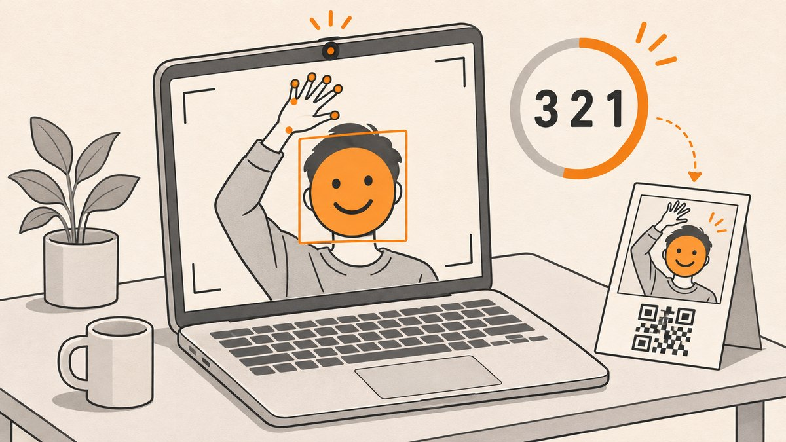

<p align="center"></p>

# AR Emoji Photo Booth

A **web-based AR Emoji Photo Booth** that uses modern browser APIs and MediaPipe for real-time face and hand tracking. Stand in front of your camera, trigger the countdown by raising your hand, cycle through fun emoji overlays via swipes, and capture downloadable photos. No servers are required beyond optional image hosting. Perfect for live events, demos, or playful online experiences!

## Demo Link

> [https://aremojibooth.netlify.app/](https://aremojibooth.netlify.app/)

## Features

- **Start Screen with Instructions**
    - Welcome screen explains how to begin (raise your hand to start) and includes a “Start” button to enter the booth.
- **Hand-Triggered Countdown**
    - Raise your hand above your head to start a 3-2-1 countdown. Lower your hand at any time; raising it again will not restart the timer during countdown.
- **Real-Time Face and Hand Tracking**
    - Utilizes MediaPipe's Face Detection (short-range model) and Hands solutions to track your face and hand movements for an immersive AR experience.
- **Emoji Overlay and Swiping**
    - Swipe your hand horizontally to cycle between 20 preloaded emojis that appear on your face. Visual hand feedback appears on your wrist when a hand is detected.
- **Photo Capture and QR Code Download**
    - Raise your hand again to trigger a photo capture. The result screen displays your image with the emoji overlay and a QR code to download the image.
- **Customizable Assets**
    - Emojis, the background, and the hand overlay are all image assets stored in folders; easily swapped out for your own designs.


## Project Structure

All app files live in the `AR_Emoji_Photo_Booth/` folder:

```
AR_Emoji_Photo_Booth/
├── index.html         # Main HTML page defining start, booth, and result screens
├── style.css          # Styles for layout, colors, and responsive design
├── app.js             # Core JavaScript: loads models, tracks face/hand, overlays emoji, handles swipes & uploads
├── emojis/            # 20 PNG emoji images (replace to customize)
├── bg/                # Background image used on booth/result screens
├── hand/              # PNG image for the hand detection overlay
└── Readme.md          # Original project notes
```


## Models Used

### Face Detection (MediaPipe)

- Imported via CDN. Uses the "short-range" model (optimized for faces within ~2m) to minimize file size and latency.


### Hands (MediaPipe)

- Two-stage pipeline: palm detector for bounding boxes, then hand-landmark model for 3D keypoints (enabling both gesture and swipe detection).
- Wrist location is used for swipe controls and overlaying the hand icon.

> See [MediaPipe documentation](https://mediapipe.readthedocs.io/) for further details on models and configurations.

## Running Locally

**Note:** Camera access requires a secure context (HTTPS or localhost over HTTP).

### Quick Start (Python or Node)

```bash
# Option 1: Python 3
python3 -m http.server 8000

# Option 2: Node (using http-server)
npx http-server -p 8000
```

Run the command from inside `AR_Emoji_Photo_Booth/`, then open [`http://localhost:8000`](http://localhost:8000) in your browser and allow camera access.

### Static Hosting

You can deploy to Netlify, GitHub Pages, Vercel, or any static host that supports HTTPS.

## Cloudinary Configuration (for Working QR Codes)

To allow users to download their photos, configure Cloudinary unsigned uploads by setting these constants in `app.js` (the repository ships with the author's own values; replace them with yours):

```js
const CLOUDINARY_CLOUD_NAME = 'your_cloud_name';
const CLOUDINARY_UPLOAD_PRESET = 'your_unsigned_preset';
```

- Create a new unsigned preset in the Cloudinary console (`Settings → Upload → Upload presets`).
- Unsigned uploads don’t expose your API secret.
- Upload endpoint format:

```
https://api.cloudinary.com/v1_1/<cloud_name>/image/upload
```

- If upload fails, a downscaled thumbnail is embedded in the QR code. Not all scanners recognize data-URI QR codes; Cloudinary hosting is recommended for best results.
    - More info: [Cloudinary docs](https://cloudinary.com/documentation/upload_images)


## Customizing Assets

### Changing Emojis

- Replace any image in `emojis/` with your own 72×72 PNG emojis (transparent background recommended).
- To add/remove emojis, modify the `emojiCodes` array at the top of `app.js` and place corresponding PNG files in `emojis/`.
- The array items must match filenames (without `.png` extension).


### Changing the Background

- Replace `bg/background.png` with your own image.
- For best visibility, use a high-resolution, vibrant background that complements the emoji theme.


### Changing the Hand Overlay

- Replace `hand/hand.png` with your own icon (such as a different hand gesture or an animated effect).
- Make sure it fits visually on the wrist.


## License

The project code is licensed under the Apache License 2.0. See [LICENSE](LICENSE).

Third-party assets and services:

- MediaPipe models: Apache 2.0
- Emoji images: [Twemoji project](https://twemoji.twitter.com/) (CC-BY 4.0)
- Cloudinary upload usage is subject to [Cloudinary Terms of Service](https://cloudinary.com/terms).


## Credits

- Emoji overlays: [Twemoji](https://twemoji.twitter.com/)
- Computer vision models: [MediaPipe](https://mediapipe.readthedocs.io/)
- QR code generation: [QRCode.js](https://github.com/davidshimjs/qrcodejs)

Enjoy your AR Emoji Photo Booth experience!

